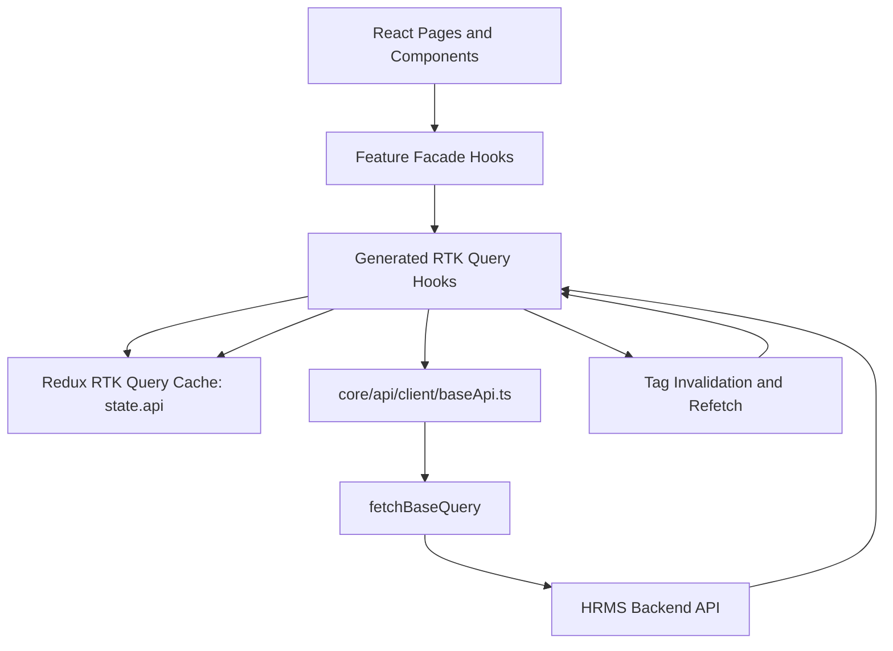
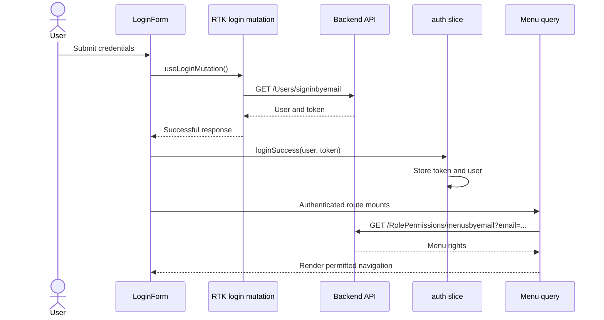

# HRMS Enterprise Portal Architecture

## 1. Overview

The HRMS Enterprise Portal is a React 19, TypeScript, Vite, Material UI, Tailwind CSS, Redux Toolkit, RTK Query, and Microsoft MSAL application.

The application uses RTK Query as the single server-state and API layer. Regular Redux slices are reserved for client-side state, primarily authentication/session state and employee list filters.

### Core principles

- API endpoints are organized by business module.
- `fetchBaseQuery` is the shared HTTP transport.
- RTK Query owns API data, loading state, errors, caching, request deduplication, and invalidation.
- Redux Toolkit owns authentication/session state and local UI state.
- Components consume feature facade hooks or generated RTK Query hooks.
- There is no Axios, TanStack Query, custom fetch wrapper, or mock API implementation.

## 2. Runtime Data Flow



### Read flow

1. A page mounts a feature hook such as `useEmployee()` or `useAuth()`.
2. The hook calls a generated RTK Query query hook.
3. RTK Query checks its Redux cache and request state.
4. If data is required, `fetchBaseQuery` sends the request.
5. The shared base API adds the API base URL, JSON headers, and the bearer token from the auth cookie.
6. The response is normalized with `transformResponse` where required.
7. The hook receives `data`, `isLoading`, `isFetching`, `isError`, and `error`.

### Mutation flow

1. A form or action calls a generated RTK Query mutation hook.
2. The mutation sends the request through `fetchBaseQuery`.
3. On success, the mutation invalidates the appropriate tag.
4. Active queries providing that tag refetch automatically.
5. The UI receives the refreshed server data without manual Redux success actions.

## 3. Project Structure

```text
src/
├── app/
│   ├── providers/
│   │   ├── AppProviders.tsx
│   │   ├── ReduxProvider.tsx
│   │   ├── RouterProvider.tsx
│   │   └── ThemeProvider.tsx
│   └── router/
│       ├── AppRouter.tsx
│       └── routes.config.ts
│
├── config/
│   ├── app.config.ts
│   ├── env.config.ts
│   └── theme.config.ts
│
├── core/
│   ├── api/
│   │   ├── client/
│   │   │   ├── baseApi.ts
│   │   │   └── index.ts
│   │   ├── auth/
│   │   │   ├── auth.api.ts
│   │   │   ├── authApi.types.ts
│   │   │   └── index.ts
│   │   ├── menu/
│   │   │   ├── menu.api.ts
│   │   │   ├── menuApi.types.ts
│   │   │   └── index.ts
│   │   ├── employee/
│   │   │   ├── employee.api.ts
│   │   │   ├── employeeApi.types.ts
│   │   │   └── index.ts
│   │   ├── leave/
│   │   ├── attendance/
│   │   ├── holiday/
│   │   ├── admin/
│   │   └── index.ts
│   ├── auth/
│   │   └── msal.config.ts
│   └── redux/
│       ├── auth/
│       │   ├── auth.slice.ts
│       │   ├── auth.actions.ts
│       │   └── auth.selectors.ts
│       ├── employee/
│       │   ├── employee.slice.ts
│       │   └── employee.selectors.ts
│       ├── hooks/
│       ├── rootReducer.ts
│       └── store.ts
│
├── features/
│   ├── authentication/
│   ├── employee/
│   ├── leave/
│   ├── attendance/
│   ├── holiday/
│   └── administration/
│
├── layouts/
├── shared/
├── styles/
└── types/
```

## 4. API Layer

### Shared base API

`src/core/api/client/baseApi.ts` defines the single RTK Query service:

- `fetchBaseQuery`
- `ENV.apiUrl` as the base URL
- JSON request headers
- bearer token injection from the auth cookie
- shared cache tag types
- the `api` Redux reducer path
- response envelope extraction for `data` and `Data` formats

The Redux store registers both the RTK Query reducer and middleware:

```ts
reducer: rootReducer,
middleware: (getDefaultMiddleware) =>
  getDefaultMiddleware({ serializableCheck: false })
    .concat(baseApi.middleware),
```

### Module APIs

Each feature owns its endpoints beside its API types:

- `src/core/api/auth/auth.api.ts`
- `src/core/api/menu/menu.api.ts`
- `src/core/api/employee/employee.api.ts`
- `src/core/api/leave/leave.api.ts`
- `src/core/api/attendance/attendance.api.ts`
- `src/core/api/holiday/holiday.api.ts`
- `src/core/api/admin/admin.api.ts`

Each module injects endpoints into the shared `baseApi`:

```ts
export const employeeQueries = baseApi.injectEndpoints({
  endpoints: (builder) => ({
    getEmployees: builder.query<PaginatedResult<Employee>, void>({
      query: () => '/Employees',
      providesTags: ['Employees'],
    }),
  }),
});
```

The module exports generated hooks such as:

```ts
useGetEmployeesQuery
useGetEmployeeByIdQuery
useCreateEmployeeMutation
useUpdateEmployeeMutation
useDeleteEmployeeMutation
```

## 5. Cache Tags and Invalidation

The shared service defines these tags:

- `Auth`
- `Menu`
- `Employees`
- `Leave`
- `Attendance`
- `Holidays`
- `AdminSettings`
- `AuditLogs`

Read endpoints use `providesTags`. Mutations use `invalidatesTags`.

Examples:

- Creating, updating, or deleting an employee invalidates `Employees`.
- Applying, reviewing, or deleting leave invalidates `Leave`.
- Creating or deleting attendance records invalidates `Attendance`.
- Creating or deleting holidays invalidates `Holidays`.
- Updating settings invalidates `AdminSettings`.
- Deleting or clearing audit logs invalidates `AuditLogs`.
- Credential login invalidates `Auth` and `Menu`.

On logout, `baseApi.util.resetApiState()` clears protected cached data so it cannot be reused by another session.

## 6. Redux Responsibilities

### Regular Redux state

The regular Redux store currently contains:

- `auth`: current user, token/session state, authentication status, and auth errors.
- `employee`: local employee filters and client-side selection support.
- `api`: RTK Query's normalized server-state cache.

### RTK Query server state

RTK Query owns:

- Menu permissions
- Employees and employee details
- Leave requests and balances
- Attendance records
- Holidays
- Administration settings
- Audit logs
- API loading and error state
- Cache lifecycle and refetching

Legacy server-data reducers and fetch thunks were removed after migration.

## 7. Authentication and Menu Flow

### Credential login



### Microsoft SSO

1. `useMsalLogin` starts the MSAL popup flow.
2. MSAL returns account claims and an access token.
3. `loginWithMsalAction` builds the application user and stores the token.
4. The auth slice becomes authenticated.
5. The menu RTK Query hook runs using the restored user email.
6. Menu permissions are transformed into navigation groups for the sidebar and route guard.

### Refresh behavior

On browser refresh:

1. The auth slice restores the user from storage and the token from the cookie.
2. `useAuth()` becomes authenticated.
3. The menu query runs with the stored email.
4. Other feature queries run when their feature pages mount.
5. RTK Query manages the request and cache state.

## 8. API Error and Response Handling

The backend may return either camelCase or PascalCase response envelopes. `extractApiData` supports both:

```ts
{ data: value }
{ Data: value }
```

HTTP failures are handled by RTK Query's `fetchBaseQuery`, and generated hooks expose the resulting error state to the feature UI.

## 9. Feature Module Pattern

Each feature follows this structure:

```text
src/features/<module>/
├── components/
├── core/
│   ├── hooks/
│   ├── types/
│   ├── constants/
│   └── utils/
├── pages/
├── validations/
└── index.ts
```

Feature hooks act as a presentation-friendly facade. They combine generated RTK Query hooks with local UI state and expose stable methods to pages.

Example:

```ts
export function useEmployee() {
  const employeesQuery = useGetEmployeesQuery();
  const [createEmployee] = useCreateEmployeeMutation();

  return {
    employees: employeesQuery.data?.items ?? [],
    isLoading: employeesQuery.isLoading,
    addEmployee: (data) => createEmployee(data).unwrap(),
  };
}
```

## 10. Authentication and Security

- MSAL is used for Microsoft Entra ID authentication.
- The application token is stored through the existing cookie utility.
- `baseApi.ts` reads the token and adds `Authorization: Bearer <token>` to API requests.
- Logout clears the token, stored user, auth state, and RTK Query cache.
- Protected routes use `ProtectedRoute` and permission-aware route guarding.

## 11. UI Architecture

The application uses:

- Material UI for accessible interactive primitives and icons.
- Tailwind CSS for layout and utility styling.
- React Hook Form and Yup for complex forms.
- Shared components for buttons, dialogs, tables, cards, loaders, notifications, and form controls.
- Main and authentication layouts for authenticated and public route shells.

## 12. Adding a New API Module

1. Add the module folder under `src/core/api/<module>/`.
2. Add `<module>Api.types.ts` for request and response types.
3. Add `<module>.api.ts` beside the types file.
4. Import `baseApi` from `../client/baseApi`.
5. Define queries and mutations with `providesTags` and `invalidatesTags`.
6. Export the endpoint hooks from the module `index.ts`.
7. Add the module barrel to `src/core/api/index.ts`.
8. Create a feature facade hook under `src/features/<module>/core/hooks/`.
9. Use the generated hooks in the facade or page.
10. Run type-check, lint, build, and feature verification.

Example:

```ts
import { baseApi } from '../client/baseApi';

export const payrollQueries = baseApi.injectEndpoints({
  endpoints: (builder) => ({
    getPayroll: builder.query<Payroll[], void>({
      query: () => '/Payroll',
      providesTags: ['Payroll'],
    }),
  }),
});
```

## 13. Environment Configuration

```env
VITE_APP_TITLE="HRMS Enterprise Portal"
VITE_APP_ENV="development"
VITE_APP_PORT=3000
VITE_API_BASE_URL="https://api.hrms-enterprise.com/v1/api"
VITE_API_TIMEOUT=15000
VITE_MSAL_CLIENT_ID="..."
VITE_MSAL_TENANT_ID="common"
VITE_MSAL_AUTHORITY="https://login.microsoftonline.com/common"
VITE_MSAL_REDIRECT_URI="http://localhost:3000/auth/login"
VITE_MSAL_SCOPES="User.Read,openid,profile,email"
VITE_AUTH_COOKIE_NAME="auth_token"
VITE_AUTH_COOKIE_EXPIRES_DAYS=7
VITE_AUTH_COOKIE_PATH="/"
VITE_AUTH_COOKIE_SECURE=false
VITE_AUTH_COOKIE_SAME_SITE="Lax"
```

There is no mock API environment flag because mock API implementations were removed.

## 14. Commands

```bash
npm install
npm run dev
npm run type-check
npm run lint
npm run build
```

The production build runs TypeScript build validation followed by Vite bundling.
